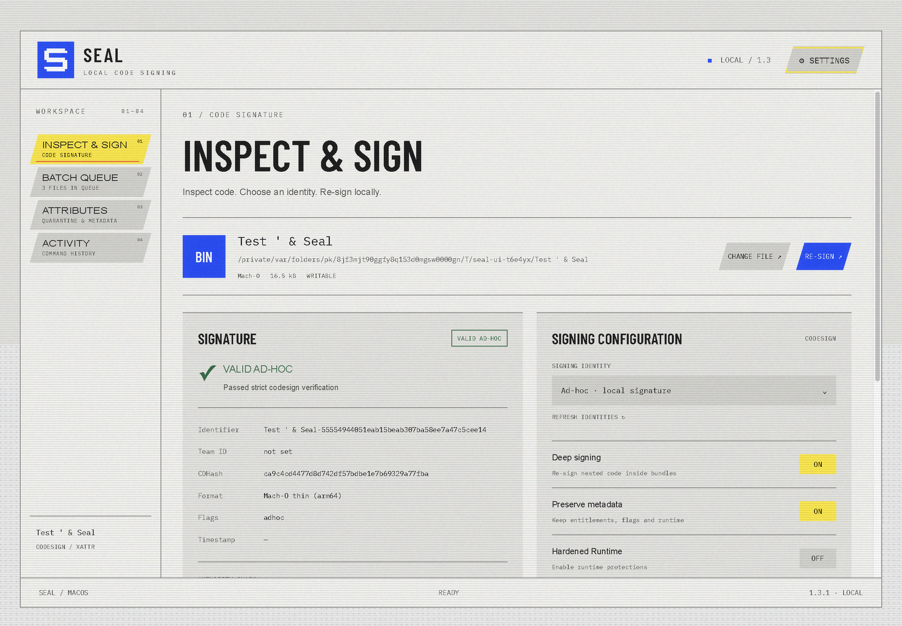

<h1 align="center"><br>Seal</h1>
<p align="center">Local macOS code signing and extended attribute management.</p>
<p align="center"><a href="./README.md">English</a> · <a href="./README.zh-CN.md">简体中文</a></p>
<p align="center"><a href="https://repology.org/projects/?search=seal"></a></p>

Seal inspects, verifies and re-signs apps, frameworks, Mach-O binaries and audio plugins. The interface uses the [AYMDevKitUI](https://github.com/Dirty-Octopus/AYMDevKitUI) Electron application shell with a local macOS process service. Files stay on your Mac; no account or upload is involved.

## Workspaces

- **Inspect & Sign**: drag in an app, plugin or binary, read its signature/entitlements, choose a keychain identity or Ad-hoc, and re-sign with automatic verification.
- **Batch Queue**: inspect and sign multiple targets sequentially, stop after the current item, retry, reveal, open individual items and clear completed entries.
- **Extended Attributes**: inspect quarantine, download origins and other metadata; remove individual entries or clear attributes, optionally recursively.
- **Activity**: copy the last 100 session entries, including the exact commands executed.

Supported bundles include `.app`, `.framework`, `.xpc`, `.appex`, `.bundle`, `.plugin`, `.kext`, `.vst3`, `.vst`, `.component` and `.aaxplugin`. Ordinary files and folders also support attribute operations. Gatekeeper assessment is separate from signature verification and is performed for signed app bundles.

## Interface

The AYM shell provides CRT curvature with mapped pointer input, a 16 × 16 blue utility mark, bundled Barlow Condensed / IBM Plex Mono, panel transitions and interface sounds. Settings include Chinese/English, system/light/dark appearance, display treatment, motion, sound, CRT, softness and window presets. Welcome appears on first launch and can be replayed from Settings.



## Shared runtime (1.3 development)

The default build now follows AYMDevKitUI's shared-runtime installer flow. Seal ships a thin application ZIP and a native online `.pkg`; it reuses the published Electron 45.1.0 runtime rather than shipping another framework archive with each app.

Installed apps live in `/Applications/Andy Yu/`. Regular framework files share physical storage through hard links to an immutable runtime cache. Each app retains its own bundle ID, process and profile. The first compatible install downloads the pinned runtime; later installs reuse it. Application installation/updates still download the small app ZIP, and installed apps run offline. Finder can continue to show the full logical size.

The upstream shared-runtime preview currently supports **Apple Silicon only**. Seal retains its macOS 14+ requirement. These new 1.3 artifacts are local development builds; their application download URLs become usable when the corresponding release assets are published. The standalone 1.2.0 release remains available below.

## Download and install

Download the universal **DMG** or **ZIP** from [Seal v1.2.0](https://github.com/Dirty-Octopus/seal/releases/tag/v1.2.0). The package includes Apple Silicon (arm64) and Intel (x86_64) code and requires macOS 14 or later. Node.js and Xcode are not required to use the packaged app.

1. Open the DMG and drag `Seal.app` into `/Applications`, or unzip the ZIP and move the app there.
2. The app is ad-hoc signed and not notarized. If macOS blocks the downloaded copy, confirm its source, then run:

```sh
xattr -dr com.apple.quarantine /Applications/Seal.app
codesign --force --deep --sign - --timestamp=none /Applications/Seal.app
open /Applications/Seal.app
```

`SHA256SUMS.txt` is included with the release for checking the DMG and ZIP. Gatekeeper may reject an ad-hoc signature even when strict signature verification passes.

## Local build and testing

Building requires macOS 14+, Node 22.12+, Python 3 and Command Line Tools for the native installer helper. Target Macs need no developer tools. The current shared-runtime build targets Apple Silicon.

```sh
bash scripts/build.sh
open dist/shared-arm64/local/Seal.app
```

The build creates `dist/shared-arm64/`: a thin app ZIP, an online installer, SHA-256 checksums and a complete local test app under `local/Seal.app`. The local test app already shares the cached runtime. It does not modify `/Applications`. `scripts/install.sh` opens the native installer, whose pinned application ZIP must first be available at its release URL.

```sh
npm test --prefix desktop
npm run runtime:test --prefix desktop -- ../dist/shared-arm64
SEAL_PACKAGED_APP="$PWD/dist/shared-arm64/local/Seal.app" npm run test:app --prefix desktop
```

The service tests cover signing and shared-file write protection. The runtime tests exercise the actual native helper in private, unprivileged test roots: two-app inode sharing, runtime reuse/offline reuse, failed-download recovery, strict signatures, process/profile isolation and the full Seal workflow. The packaged-app test uses temporary signing targets and saves screenshots in `dist/qa/`. Tests do not install into the real `/Applications`.

`bash scripts/package_release.sh` produces the thin shared-runtime installer and app assets without publishing them. The runtime ZIP remains hosted by AYMDevKitUI. The current preview is ad-hoc signed, with an unsigned installer and no notarization. For an independent standalone build, use `scripts/build_standalone.sh`; `scripts/package_standalone.sh` retains universal DMG/ZIP packaging. The previous Swift source remains available as reference; `scripts/build_native.sh` builds it separately to `dist/Seal-native.app`. See [desktop/README.md](./desktop/README.md) for architecture and development details.

## Signing and permissions

Seal refuses in-place signing or attribute writes on shared hard-linked files and immutable runtime caches. Recursive operations check the entire selected target before changing it. Copy an app to an independent location before re-signing it; never re-sign installed shared frameworks in place. Private top-level directory attributes can still be managed separately.

Seal uses `codesign`, `xattr`, `security` and `spctl` with the current user's permissions. It does not invoke `sudo`. Copy read-only targets to a writable location before modifying them.

Ad-hoc is the default identity. Deep signing, metadata preservation and quarantine removal are enabled by default. Certificate signing can optionally use Apple's timestamp service. Ad-hoc signing supports local use; distribution signing and notarization are separate processes.

The local app is not notarized. If macOS blocks a downloaded copy, verify its source before removing quarantine or applying your own signature. App signature verification and Gatekeeper acceptance are shown separately.

Language, appearance and window settings persist locally. Queues, signing options and logs are session-only. Recursive attribute deletion acts on symbolic links themselves, leaving external linked targets untouched; macOS may retain or recreate protected attributes such as `com.apple.provenance`.

## License and credits

MIT, see [LICENSE](./LICENSE). The UI is based on AYMDevKitUI at commit `ad8f98b`; its license, source mapping and font licenses are retained in [desktop/UPSTREAM.md](./desktop/UPSTREAM.md). Seal is not affiliated with Apple.
