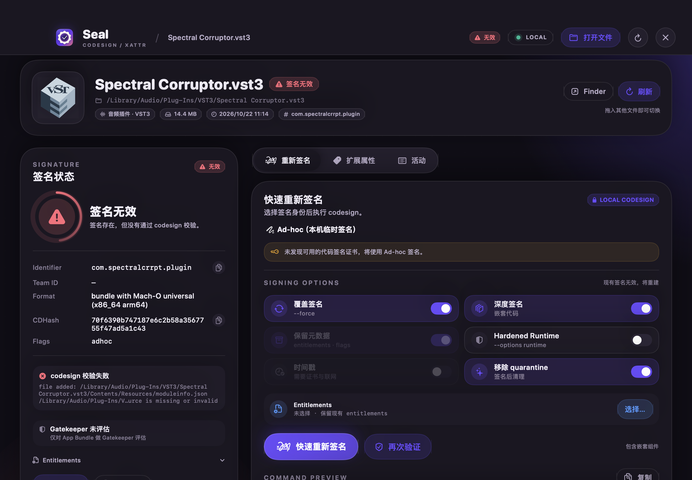
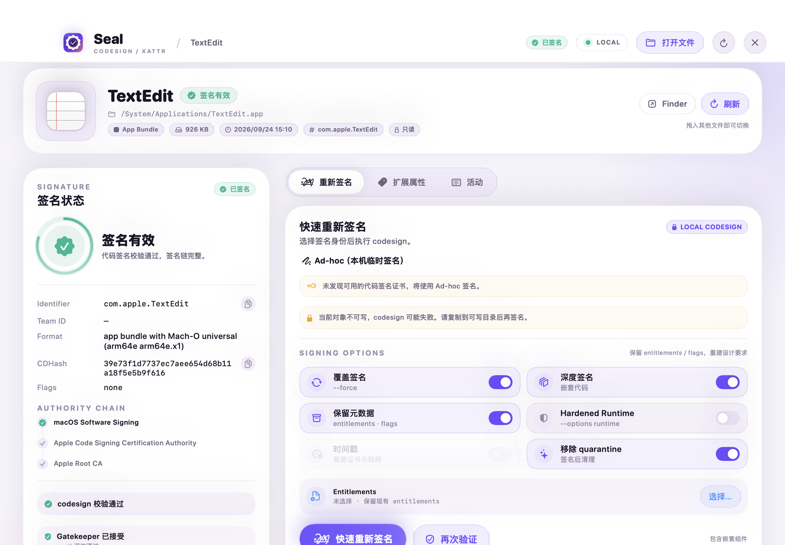

<h1 align="center">
  
  <br>
  Seal
</h1>

<h3 align="center">macOS 本地 <code>codesign</code> 与 <code>xattr</code> 图形工具</h3>

<p align="center">
  <a href="./README.md">English</a> ·
  <a href="./README.zh-CN.md">简体中文</a>
</p>

<p align="center">
  <a href="https://github.com/Dirty-Octopus/seal/releases/latest"></a>
  
  
  
</p>

Seal 是一个本地 macOS 工具，用于检查、验证和重签代码。它把系统的 `codesign`、`xattr`、`spctl`、`security` 命令封装成拖拽界面，支持 App、Framework、Mach-O 二进制，以及 VST3、VST、Audio Unit、AAX 等音频插件包。

不需要账号，不收集遥测，不上传文件。

## 预览

| 深色 | 浅色 |
| --- | --- |
|  |  |

## 安装

请到 [Releases 页面](https://github.com/Dirty-Octopus/seal/releases/latest) 下载最新的 universal DMG 或 ZIP。

1. 打开 DMG，把 `Seal.app` 拖入 `/Applications`；或解压 ZIP 后移动到 `/Applications`。
2. 如果 macOS 首次启动时拦截应用，在终端执行：

```bash
xattr -dr com.apple.quarantine /Applications/Seal.app
codesign --force --deep --sign - /Applications/Seal.app
open /Applications/Seal.app
```

> 由于本软件是开源项目且开发者未向苹果缴纳99美元保护费，安装后请手动执行上述命令。或者，你可以用 Seal 来管理你自己的签名（如果你有证书的话）。

发布包使用 ad-hoc 签名，未经过 Apple 公证。上述命令会移除 quarantine 标记并重新应用 ad-hoc 签名。它适合在本机使用；ad-hoc 签名不能替代 Developer ID 签名与公证。

需要 macOS 14 或更高版本。发布包为 Apple Silicon 与 Intel 通用二进制。

## 支持的目标

| 类型 | 说明 |
| --- | --- |
| App 与 bundle | `.app`、`.framework`、`.xpc`、`.appex`、`.bundle`、`.plugin`、`.kext` |
| 音频插件 | `.vst3`、`.vst`、`.component`（Audio Unit）、`.aaxplugin` |
| 二进制 | Mach-O 可执行文件与动态库 |
| 文件与文件夹 | 查看和移除扩展属性 |

对于插件包，Seal 会读取 `Info.plist`、显示签名链；启用深度签名时，会重签包内嵌套代码。

## 功能

- 拖拽文件、App、Framework 或音频插件到窗口。
- 读取当前签名：Identifier、Team ID、Format、CDHash、Authority 链、flags、Timestamp、Entitlements。
- 使用 `codesign --verify --deep --strict` 验证签名。
- 对 App Bundle 执行 `spctl` 评估并显示 Gatekeeper 结果。
- 从钥匙串读取可用代码签名证书。
- 使用证书重签；没有证书时使用 Ad-hoc 签名。
- 配置深度签名、保留元数据、Hardened Runtime、时间戳、Entitlements 和 quarantine 清理。
- 查看扩展属性（包括 `com.apple.quarantine`），支持单项移除和递归清除。
- 活动日志记录实际执行的命令。
- 不上传文件，不收集遥测。

## 使用

1. 拖入目标文件，或点击「打开文件」。
2. 在左侧查看签名状态和验证结果。
3. 打开「重新签名」，选择身份和选项，点击「快速重新签名」。
4. 打开「扩展属性」查看或移除 xattr。

## 常见问题

### macOS 提示 Seal 已损坏、无法打开或来自未识别的开发者

执行[安装](#安装)部分的命令。发布包使用 ad-hoc 签名，未经过 Apple 公证。

### 需要付费 Apple Developer 账号吗？

本机使用不需要。Ad-hoc 签名足够在本机测试。若要对外分发，请使用 Developer ID 证书并完成公证。

### Seal 需要管理员权限吗？

不需要。Seal 使用当前用户权限运行。如果目标不可写，请先复制到可写目录。Seal 不会默认调用 `sudo`。

### 可以签 Apple 系统 App 吗？

不可以。系统 App 受 SIP 保护，所在卷通常只读。请先复制到可写目录。

### 支持 VST3、VST 和 Audio Unit 吗？

支持。`.vst3`、`.vst`、`.component` 和 `.aaxplugin` 会按代码 bundle 处理，并默认启用深度签名。

### Seal 会上传文件吗？

不会。Seal 不上传文件，也不收集遥测。只有手动启用时间戳选项时，`codesign` 可能连接 Apple 时间戳服务。

## 开发

环境要求：

- macOS 14 或更高版本
- 安装 Xcode（SwiftUI 宏需要 Xcode 工具链；仅 Command Line Tools 不足）
- 已在 Xcode 27.1 上测试

构建：

```bash
bash scripts/build.sh
```

安装本地构建到 `/Applications`：

```bash
bash scripts/install.sh
```

安装脚本会先尝试普通复制；只有权限不足时，才通过 `osascript` 打开 macOS 系统管理员认证窗口，不会默认执行 `sudo`。

构建 universal Release（DMG、ZIP、SHA-256 校验文件）：

```bash
bash scripts/package_release.sh
```

产物位于 `dist/`。

## 贡献

欢迎提交 Issue 和 Pull Request。反馈签名问题时，请附上 macOS 版本、目标类型和 `codesign` 输出。

## 致谢

- Apple 的 `codesign`、`xattr`、`spctl`、`security` 工具。
- SwiftUI 与 AppKit。
- 界面参考 Material 3 Expressive。
- README 布局参考 [Clash Verge Rev](https://github.com/clash-verge-rev/clash-verge-rev)。

Seal 与 Apple 无关联。

## 隐私

Seal 不收集使用数据，不上传文件。所有检查和签名操作都在本机执行。启用时间戳选项时，`codesign` 可能连接 Apple 时间戳服务。

## 许可证

MIT，详见 [LICENSE](./LICENSE)。
