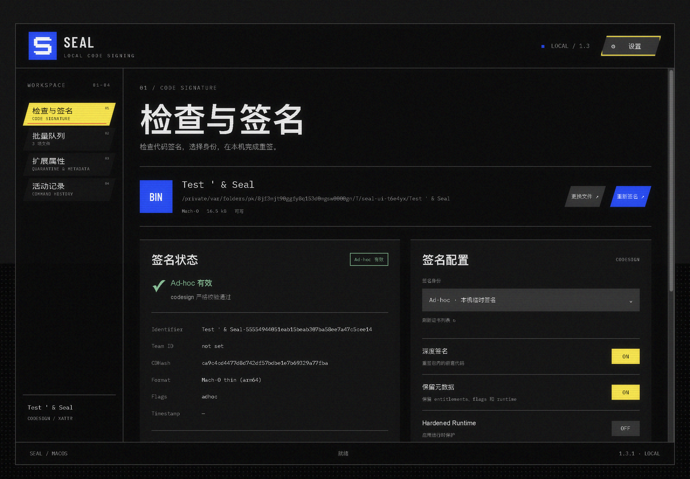

<h1 align="center"><br>Seal</h1>
<p align="center">macOS 本地签名与扩展属性管理工具</p>
<p align="center"><a href="./README.md">English</a> · <a href="./README.zh-CN.md">简体中文</a></p>
<p align="center"><a href="https://repology.org/projects/?search=seal"></a></p>

Seal 用于检查、验证和重新签名 App、Framework、Mach-O 二进制与音频插件。界面采用 [AYMDevKitUI](https://github.com/Dirty-Octopus/AYMDevKitUI) 的 Electron 应用框架，接入本地 macOS 进程服务。无需账号，不上传文件。

## 工作区

- **检查与签名**：拖入 App、插件或二进制，查看签名和 Entitlements，选择钥匙串证书或 Ad-hoc 身份，重签后自动验证。
- **批量队列**：依次检查和签名多个目标；停止会等待当前项结束。支持单项重试、Finder 定位、打开检查和清空已完成项目。
- **扩展属性**：查看 quarantine、下载来源和其他元数据；可单项删除或清空，支持递归处理。
- **活动记录**：保留本次会话最近 100 条记录，包含实际执行的命令，可复制。

支持 `.app`、`.framework`、`.xpc`、`.appex`、`.bundle`、`.plugin`、`.kext`、`.vst3`、`.vst`、`.component`、`.aaxplugin` 等代码包。普通文件和文件夹也支持扩展属性操作。签名校验与 Gatekeeper 评估分别显示，后者仅用于带签名的 App Bundle。

## 界面

使用 AYM 的 CRT 曲面及鼠标坐标映射、16 × 16 蓝色工具标识、本地字体、面板转场和交互音效。设置包含中英文、跟随系统/浅色/深色、显示处理、动效、音效、CRT、柔化和窗口尺寸预设。欢迎页只在首次启动出现，之后可在设置中重播。



## 共享运行时（1.3 预览版）

默认构建已跟进 AYMDevKitUI 的 shared runtime 流程，输出薄应用 ZIP 和原生在线安装器 `.pkg`，复用官方已发布的 Electron 45.1.0 运行时，不再为每个软件发布一份相同的 Framework。

应用安装在 `/Applications/Andy Yu/`。框架中的普通文件通过硬链接复用不可变缓存的物理存储，各应用仍保留独立包标识、进程和配置。首次安装下载固定运行时，后续兼容应用复用；安装或更新应用时仍需下载小体积的应用 ZIP。安装完成后可离线运行。Finder 可能仍显示完整的逻辑体积。

上游当前已验证的共享运行时预览仅支持 **Apple Silicon**，Seal 仍要求 macOS 14+。[v1.3.0 共享运行时预览版](https://github.com/Dirty-Octopus/seal/releases/tag/v1.3.0) 提供原生在线安装器，属于安装器未签名、应用未公证的开发预览。Intel 用户或希望使用独立应用包的用户，仍可下载下方的 1.2.0 通用版。

## 下载与安装

### 共享运行时预览版：Apple Silicon

从 [v1.3.0](https://github.com/Dirty-Octopus/seal/releases/tag/v1.3.0) 下载 [Seal-Shared-arm64-Preview.pkg](https://github.com/Dirty-Octopus/seal/releases/download/v1.3.0/Seal-Shared-arm64-Preview.pkg)，需要 Apple Silicon 和 macOS 14+。

1. 安装或更新前，先退出所有正在运行的 Seal。
2. 使用 macOS 系统安装器打开 `.pkg`。安装器会下载或复用固定的 AYM 运行时，下载 Seal 薄应用包，并在替换前验证完整应用。
3. 从 `/Applications/Andy Yu/Seal.app` 启动。

安装器约 **56 KiB**，Seal 应用下载约 **4.1 MiB**；首次兼容安装还需下载约 **113 MiB** 的共享运行时，后续应用复用。目标电脑无需安装 Node.js、Python 或开发工具。

应用 ZIP 是固定校验值的安装器依赖，**不能当作独立应用直接解压运行**。`SHA256SUMS.txt` 用于核对安装器和 ZIP。旧的 `/Applications/Seal.app` 不会自动删除。本预览版安装器未签名，应用使用 Ad-hoc 签名，未经过 Apple 公证。不要原地重签已安装的共享框架，也不要对它们递归清理属性。

### 独立版：Apple Silicon 与 Intel

从 [Seal v1.2.0](https://github.com/Dirty-Octopus/seal/releases/tag/v1.2.0) 下载 universal **DMG** 或 **ZIP**。安装包包含 Apple Silicon（arm64）与 Intel（x86_64）代码，需要 macOS 14 或更高版本。使用成品应用无需安装 Node.js 或 Xcode。

1. 打开 DMG，将 `Seal.app` 拖入 `/Applications`；或解压 ZIP 后将应用移入该目录。
2. 应用使用 Ad-hoc 签名，未经过 Apple 公证。如果 macOS 拦截下载的副本，确认来源后执行：

```sh
xattr -dr com.apple.quarantine /Applications/Seal.app
codesign --force --deep --sign - --timestamp=none /Applications/Seal.app
open /Applications/Seal.app
```

发布附件中的 `SHA256SUMS.txt` 可用于核对 DMG 和 ZIP。严格签名校验通过与 Gatekeeper 接受是两个独立结果，Ad-hoc 签名仍可能被 Gatekeeper 拒绝。

## 本地构建与测试

构建需要 macOS 14+、Node 22.12+、Python 3 和用于编译原生安装助手的 Command Line Tools。目标电脑不需要开发工具。当前共享版构建面向 Apple Silicon。

```sh
bash scripts/build.sh
open dist/shared-arm64/local/Seal.app
```

产物位于 `dist/shared-arm64/`：薄应用 ZIP、在线安装器、SHA-256 校验文件，以及 `local/Seal.app` 完整本地测试应用。测试应用已复用缓存中的运行时，构建不会修改 `/Applications`。`scripts/install.sh` 会打开系统安装器。重新构建后若应用内容有变化，需要发布新的固定应用 ZIP 后才能在线安装；未发布构建可使用 `local/Seal.app` 测试。

```sh
npm test --prefix desktop
npm run runtime:test --prefix desktop -- ../dist/shared-arm64
SEAL_PACKAGED_APP="$PWD/dist/shared-arm64/local/Seal.app" npm run test:app --prefix desktop
```

服务测试覆盖签名和共享文件写入保护。运行时测试使用真实原生助手，在隔离的非特权目录验证双应用 inode 共享、缓存及离线复用、下载失败恢复、严格签名、进程与配置隔离，并运行完整 Seal 工作流。应用测试仅操作临时签名目标，截图位于 `dist/qa/`。测试不安装到真实 `/Applications`。

`scripts/package_release.sh` 输出共享版薄安装器和应用附件，不自动发布，也不另行打包官方运行时 ZIP。当前为 Ad-hoc 开发预览，安装器未签名、未经过 Apple 公证。独立版构建保留在 `scripts/build_standalone.sh`，通用 DMG/ZIP 打包保留在 `scripts/package_standalone.sh`。原 Swift 源码保留作参考，可通过 `scripts/build_native.sh` 单独构建到 `dist/Seal-native.app`。架构与开发说明见 [desktop/README.md](./desktop/README.md)。

## 签名与权限

Seal 会拒绝直接重签共享硬链接文件，或修改不可变运行时缓存。递归属性操作会先检查整个目标，再开始修改。需要重签时，请先复制到独立位置；不要原地重签已安装的共享框架。目录本身独立的顶层属性仍可单独处理。

Seal 使用当前用户权限调用 `codesign`、`xattr`、`security`、`spctl`，不调用 `sudo`。目标只读时，请先复制到可写位置。

默认使用 Ad-hoc 身份，并开启深度签名、保留元数据和清理隔离标记。使用证书时可选 Apple 时间戳服务。Ad-hoc 适合本机使用，对外分发所需的证书签名和公证需另行完成。

本地构建未经过 Apple 公证。macOS 拦截下载的副本时，应先确认来源，再移除隔离标记或使用自己的身份签名。签名验证成功与 Gatekeeper 接受是两个独立结果。

语言、外观和窗口设置会保存在本机；队列、签名选项和日志仅保留在当前会话。递归清理对符号链接本身操作，不修改它指向的外部文件。macOS 可能保留或重新生成 `com.apple.provenance` 等受保护属性。

## 许可证与致谢

MIT，见 [LICENSE](./LICENSE)。界面基于 AYMDevKitUI 的 `ad8f98b` 提交，许可证、来源映射和字体许可保留在 [desktop/UPSTREAM.md](./desktop/UPSTREAM.md)。Seal 与 Apple 无关联。
