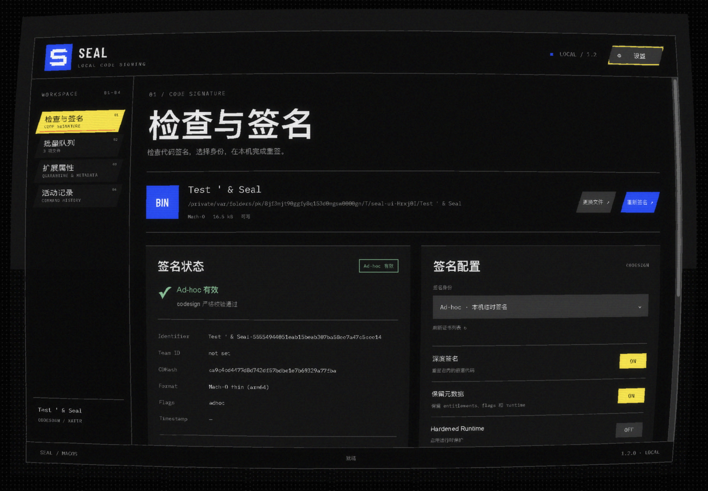

<h1 align="center"><br>Seal</h1>
<p align="center">macOS 本地签名与扩展属性管理工具</p>
<p align="center"><a href="./README.md">English</a> · <a href="./README.zh-CN.md">简体中文</a></p>

Seal 用于检查、验证和重新签名 App、Framework、Mach-O 二进制与音频插件。1.2 版采用 [AYMDevKitUI](https://github.com/Dirty-Octopus/AYMDevKitUI) 的 Electron 应用框架，接入本地 macOS 进程服务。无需账号，不上传文件。

## 工作区

- **检查与签名**：拖入 App、插件或二进制，查看签名和 Entitlements，选择钥匙串证书或 Ad-hoc 身份，重签后自动验证。
- **批量队列**：依次检查和签名多个目标；停止会等待当前项结束。支持单项重试、Finder 定位、打开检查和清空已完成项目。
- **扩展属性**：查看 quarantine、下载来源和其他元数据；可单项删除或清空，支持递归处理。
- **活动记录**：保留本次会话最近 100 条记录，包含实际执行的命令，可复制。

支持 `.app`、`.framework`、`.xpc`、`.appex`、`.bundle`、`.plugin`、`.kext`、`.vst3`、`.vst`、`.component`、`.aaxplugin` 等代码包。普通文件和文件夹也支持扩展属性操作。签名校验与 Gatekeeper 评估分别显示，后者仅用于带签名的 App Bundle。

## 界面

使用 AYM 的 CRT 曲面及鼠标坐标映射、16 × 16 蓝色工具标识、本地字体、面板转场和交互音效。设置包含中英文、跟随系统/浅色/深色、显示处理、动效、音效、CRT、柔化和窗口尺寸预设。欢迎页只在首次启动出现，之后可在设置中重播。



## 本地构建与测试

需要 macOS 14+、Node 22.12+。本次迁移在 Apple Silicon 上验证。

```sh
bash scripts/build.sh
open dist/Seal.app
```

产物为 `dist/Seal.app`，使用 Ad-hoc 签名。构建不会覆盖 `/Applications/Seal.app`，也不会发布。需要另行安装时，可使用 `bash scripts/install.sh`。

```sh
npm test --prefix desktop
npm run test:app --prefix desktop
```

第一条命令验证本地服务和界面基础逻辑；第二条会启动真实 Electron，使用临时文件检查签名、重签和属性操作，并把截图写入 `dist/qa/`。临时测试程序的编译需要 Command Line Tools。

`scripts/package_release.sh` 是单独的 universal DMG/ZIP 打包入口。本地 arm64 构建不代表已验证 universal 发布或 Apple 公证。原 Swift 源码保留作参考，可通过 `scripts/build_native.sh` 单独构建到 `dist/Seal-native.app`。架构与开发说明见 [desktop/README.md](./desktop/README.md)。

## 签名与权限

Seal 使用当前用户权限调用 `codesign`、`xattr`、`security`、`spctl`，不调用 `sudo`。目标只读时，请先复制到可写位置。

默认使用 Ad-hoc 身份，并开启深度签名、保留元数据和清理隔离标记。使用证书时可选 Apple 时间戳服务。Ad-hoc 适合本机使用，对外分发所需的证书签名和公证需另行完成。

本地构建未经过 Apple 公证。macOS 拦截下载的副本时，应先确认来源，再移除隔离标记或使用自己的身份签名。签名验证成功与 Gatekeeper 接受是两个独立结果。

语言、外观和窗口设置会保存在本机；队列、签名选项和日志仅保留在当前会话。递归清理对符号链接本身操作，不修改它指向的外部文件。macOS 可能保留或重新生成 `com.apple.provenance` 等受保护属性。

## 许可证与致谢

MIT，见 [LICENSE](./LICENSE)。界面基于 AYMDevKitUI 的 `ad8f98b` 提交，许可证、来源映射和字体许可保留在 [desktop/UPSTREAM.md](./desktop/UPSTREAM.md)。Seal 与 Apple 无关联。
